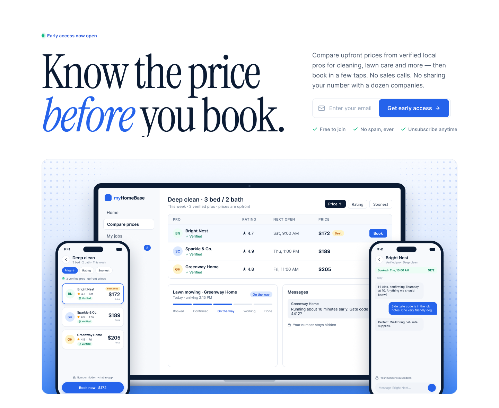
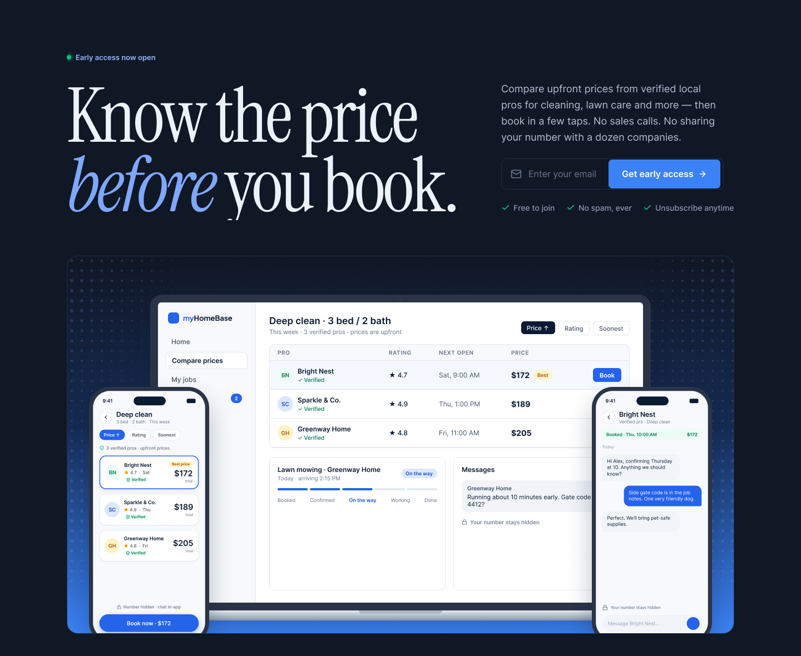
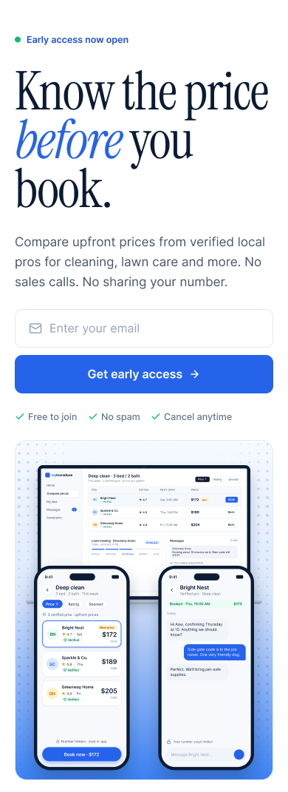
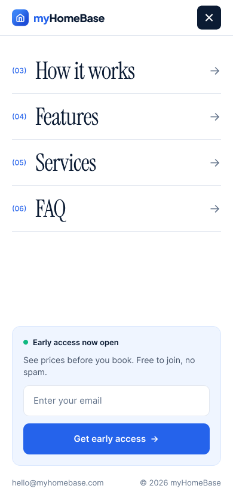
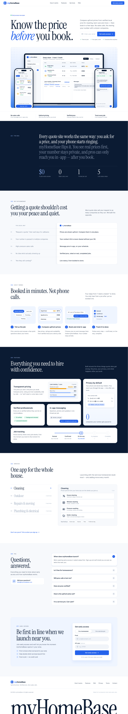
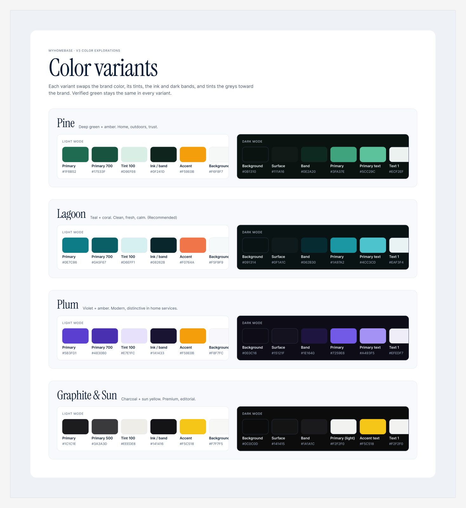

# myHomeBase — Landing Page

**Know the price before you book.**

Pre-launch marketing site for **myHomeBase**, a home-services marketplace where homeowners compare upfront prices from verified local pros (cleaning, lawn care, repairs and more), book in a few taps, and chat in-app — without their phone number being passed to a dozen companies.

# NOTE: This is not an offical website, its a more of showcase/demo of the index page only

The page has one job: get visitors to **sign up for early access**.



> Screenshots are exported from the v3 design in Figma. The site is built to match it.

---

## Showcase

### Light and dark mode

| Light | Dark |
| --- | --- |
|  |  |

In dark mode the page and sections go dark, while the laptop and phone screens stay light — the product UI reads clearly on any background.

### Mobile

| Hero | Menu (open) |
| --- | --- |
|  |  |

### The whole page



Navigation → Hero → Promise strip → The idea → Why myHomeBase (comparison) → How it works → Features → Services → FAQ → Early access signup → Footer

### Color versions

Five palettes, each with a light and dark mode, switchable live from the floating theme menu (bottom-left of the page):



**Blue** (v3 Editorial, default) · **Pine** · **Lagoon** · **Plum** · **Graphite & Sun**

---

## Features

- **Editorial design** — Instrument Serif headlines, Inter for everything else, and the product UI as the main imagery (no stock photos).
- **Animated, not noisy** — a one-time hero entrance; sections reveal as you scroll; the hero phone replays an in-app chat; the statement lights up word by word as you read; price bars, timelines and cards animate in their own sections.
- **Smooth scrolling** — soft, eased wheel/trackpad scrolling, with nav and footer links gliding to their section. Touch scrolling stays native.
- **Theme menu** — switch palette (5) and light/dark mode at runtime; the choice is remembered.
- **Responsive** — designed mobile-first, with layouts for phone, tablet and desktop, including a full-screen mobile menu.
- **Accessible** — semantic headings and landmarks, keyboard-friendly menus and accordion, visible focus states, and every animation (plus smooth scrolling) is skipped when the visitor's device asks for reduced motion.

## Tech stack

| | |
| --- | --- |
| Framework | [React 19](https://react.dev) + [TypeScript](https://www.typescriptlang.org) |
| Build | [Vite](https://vite.dev) |
| Styles | [Sass](https://sass-lang.com) / CSS Modules, with CSS-variable themes |
| Animation | [Motion](https://motion.dev) (`motion/react`, via `LazyMotion` for a smaller bundle) |
| Smooth scroll | [Lenis](https://lenis.darkroom.engineering) |
| Icons | [Lucide](https://lucide.dev) |
| Hosting | [Vercel](https://vercel.com) |

## Getting started

Requires [Node.js](https://nodejs.org) 20.19+ or 22.12+ (what Vite needs).

```bash
npm install
```

```bash
npm run dev
```

Then open http://localhost:5173.

| Command | What it does |
| --- | --- |
| `npm run dev` | Start the dev server with hot reload |
| `npm run build` | Type-check and build for production into `dist/` |
| `npm run preview` | Serve the production build locally |
| `npm run lint` | Run ESLint |

## Project structure

```
src/
├── App.tsx                  # Page: sections in order + theme menu + smooth scroll
├── main.tsx                 # Entry: applies the saved theme before first paint
├── components/
│   ├── Navbar.tsx           # Nav + animated mobile menu
│   ├── Hero.tsx             # Headline, email capture
│   ├── ShowcasePanel.tsx    # Laptop + two phones (scaled canvas, chat replay)
│   ├── promisStrip.tsx      # Four promises
│   ├── statement.tsx        # "The idea" — scroll-lit statement + stats
│   ├── comparsion.tsx       # The usual way vs. myHomeBase
│   ├── howItWorks.tsx       # Four steps
│   ├── features.tsx         # Bento grid
│   ├── services.tsx         # Category index + detail card
│   ├── FAQ.tsx              # Accordion
│   ├── finalCTA.tsx         # Early-access signup form
│   ├── footer.tsx           # Links + wordmark
│   ├── HeaderRow.tsx        # Shared section header
│   ├── ThemeMenu.tsx        # Floating palette / light-dark switcher
│   ├── themeConfig.ts       # Palette list, save/apply theme
│   ├── motionPresets.ts     # Shared easing + scroll-reveal helpers
│   └── smoothScroll.ts      # Lenis setup + in-page link handling
└── styles/
    ├── _themes.scss         # All 5 palettes × light/dark (CSS variables)
    ├── _variables.scss      # $color-* names → theme variables, fonts, breakpoints
    ├── _mixins.scss         # Breakpoint mixins + alpha() helper
    └── global.scss          # Base styles
```

## Theming

Colors are CSS variables, so the site can change palette and mode without a rebuild.

- **Use the existing names.** Components keep using `$color-*` (e.g. `$color-blue600Primary`, `$color-surface`). Each one points at a CSS variable defined in [`src/styles/_themes.scss`](src/styles/_themes.scss).
- **Palette and mode** are set on `<html>`: `data-palette="pine" | "lagoon" | "plum" | "graphite"` (none = Blue) and `data-theme="dark"` (none = light).
- **Edit a palette** in the `$palettes` map in `_themes.scss` — each palette has a `light` and a `dark` set.
- **Transparency:** use `alpha($color-…, 12%)` instead of `rgba()` (Sass's `rgba()` can't read CSS variables).
- **Hide the theme menu** by setting `SHOW_THEME_MENU = false` in [`src/App.tsx`](src/App.tsx). The site then stays on Blue, light.


## Design

The design lives in Figma: **myHomeBase — Landing Page**, including the v3 desktop/mobile pages, every color version in light and dark, and a style guide with the typography and color tokens.
